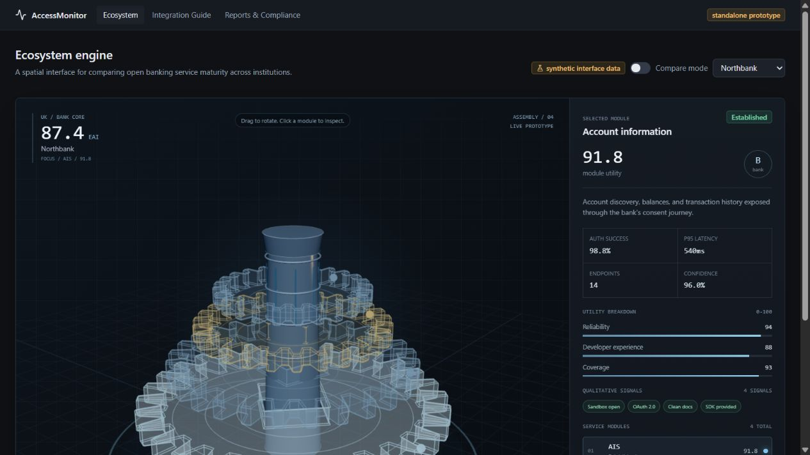
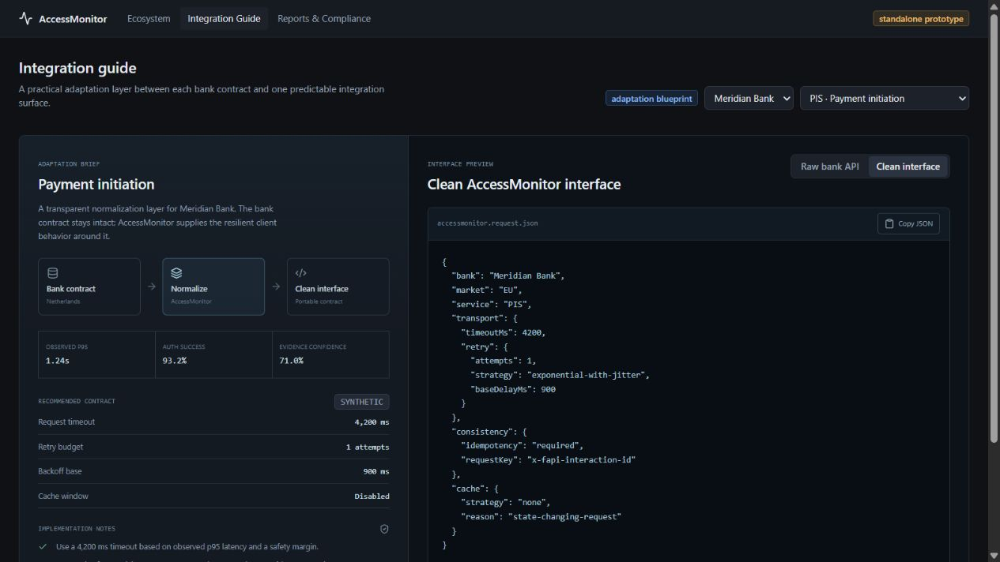
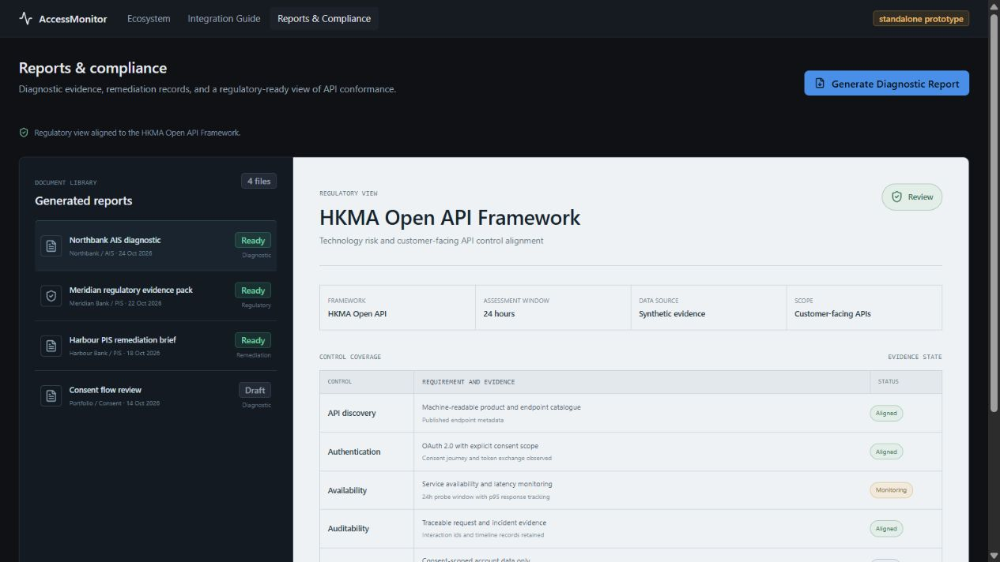

# AccessMonitor UI/UX Concept Demo

A self-contained visual concept for AccessMonitor, an adaptation and intelligence
layer for Open Banking integrations.

The demo reframes the product around three focused workspaces:

- **Ecosystem Engine**: an interactive 3D view of a bank's API service maturity.
- **Integration Guide**: bank-specific guidance for timeouts, retries, caching,
  and interface normalization.
- **Reports & Compliance**: a generated-document library and an HKMA Open API
  Framework evidence view.

## Quick Start

Open `AccessMonitor-UI-UX-Concept-Demo.html` in a modern browser. No server,
installation, or network connection is required.

The standalone demo uses hash navigation, so all three tabs work when opened
directly from disk.

## Demo Walkthrough

### Ecosystem Engine

- Rotate and zoom the 3D bank engine.
- Select service modules to inspect their score and evidence.
- Hover over a module to see its EAI score directly in the scene.
- Toggle **Compare mode** to view Bank A and Bank B side by side.
- Compare qualitative developer signals such as sandbox access, OAuth support,
  documentation quality, and SDK availability.



### Integration Guide

- Select a bank and API service.
- Toggle between the **Raw bank API** and the **AccessMonitor clean interface**.
- Review the recommended timeout, retry budget, backoff, and cache behavior.
- Copy the generated JSON contract for implementation planning.



### Reports & Compliance

- Browse the generated document library.
- Select **Generate Diagnostic Report** to download a one-page mock PDF titled
  `Diagnostic Report by AccessMonitor`.
- Review the HKMA Open API Framework regulatory view and its evidence states.



## Demo Data

All values are synthetic UI/UX fixtures. They are intended to demonstrate
interaction patterns and information architecture, not production performance,
regulatory certification, or real bank behavior.

The data model is intentionally separated from the visual layer so production
scores, evidence, and report metadata can be connected later.

## Technical Notes

- React 18 for the application shell and interaction state.
- Three.js for the interactive 3D ecosystem scene.
- Vite for the development and production build.
- Client-side PDF generation for the diagnostic report download.
- Hash-based routing in the standalone HTML build.

The original implementation lives in the AccessMonitor repository under
`apps/web/src`.

To regenerate the standalone HTML from the repository:

```powershell
pnpm --filter @accessmonitor/web export:ecosystem-html
```

## Package Contents

```text
UI-UX-Concept-Demo/
  README.md
  AccessMonitor-UI-UX-Concept-Demo.html
  pdf/
    diagnostic-report-sample.pdf
  previews/
    01-ecosystem.png
    02-integration-guide.png
    03-reports-compliance.png
```

## Status

UI/UX concept demo. This package is ready for stakeholder review and product
validation, not production deployment.
